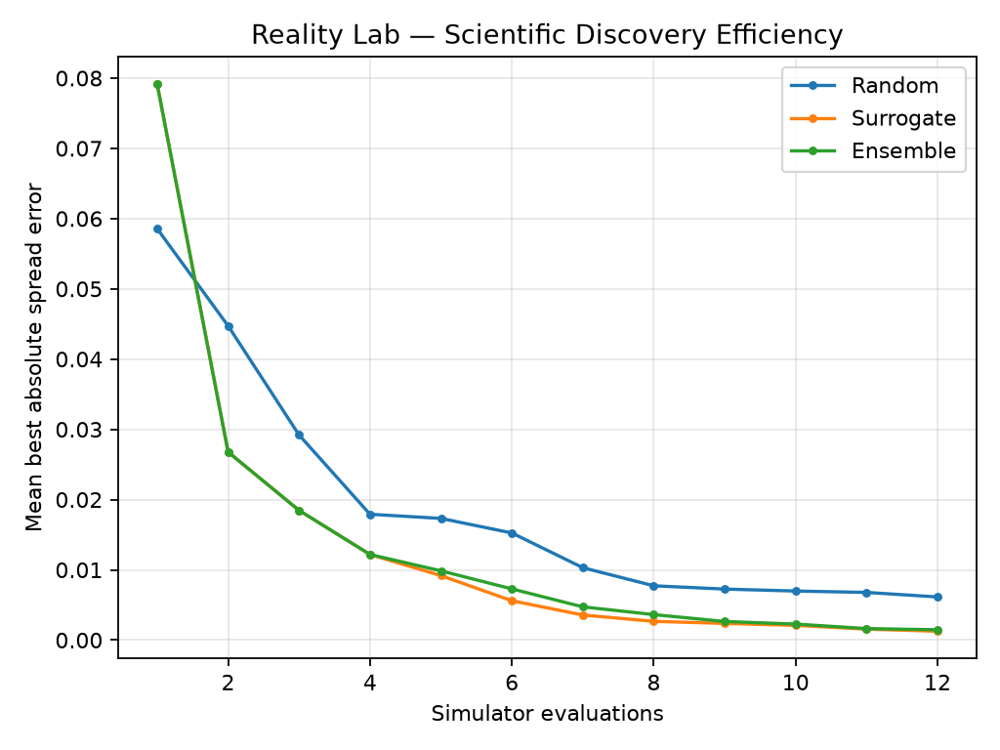

# Reality Lab

Reality Lab is an experimental scientific-computing workspace for building
simulation, optimization, and autonomous discovery systems.

The project explores a simple idea:

> Can a computer propose designs, simulate their physical behavior, evaluate the
> results, and use what it learns to search for better designs?

The current system uses a two-dimensional diffusion problem as the first testbed for that workflow.

## Current Capabilities

Reality Lab currently includes:

- a Python scientific-computing core
- a 2D finite-difference diffusion simulator
- Gaussian initial conditions
- explicit stability checking
- time-resolved simulation trajectory capture
- a diffusion design oracle
- objective-based design evaluation
- reproducible random search
- adaptive coarse-to-fine optimization
- experiment history logging
- search trajectory and convergence visualizations
- a FastAPI service
- a Next.js web interface

## Autonomous Discovery Loop

The current discovery workflow is:

```text
design space
    ↓
generate candidate designs
    ↓
physics simulation
    ↓
measure physical response
    ↓
calculate objective
    ↓
select promising designs
    ↓
refine the search region
    ↓
repeat

```


## Scientific ML — Surrogate Optimization

Reality Lab extends its diffusion simulator with
surrogate-assisted optimization and uncertainty-aware
ensemble search.

### Benchmark Results

We compared three strategies across 20 random seeds,
using 12 simulator evaluations per strategy.

| Strategy | Mean Best Absolute Error |
|---|---:|
| Random Search | 0.00613846 |
| RBF Surrogate | **0.00125978** |
| Ensemble Surrogate | 0.00147177 |

The RBF surrogate achieved approximately **79.5% lower
mean error** than random search in this experiment.

### Learning Curves



The graph shows best-so-far absolute spread error
averaged across 20 random seeds.

The methods use equal simulation budgets, but their
initial sampling strategies differ. These results
do not isolate surrogate guidance from initialization.

### Reproduce the Experiment

Run from the repository root:

```bash
PYTHONPATH=packages/reality-core/src \
uv run python experiments/discovery/benchmark_learning_curves.py
```

The experiment saves a CSV and PNG to
`experiments/discovery/results/`.

